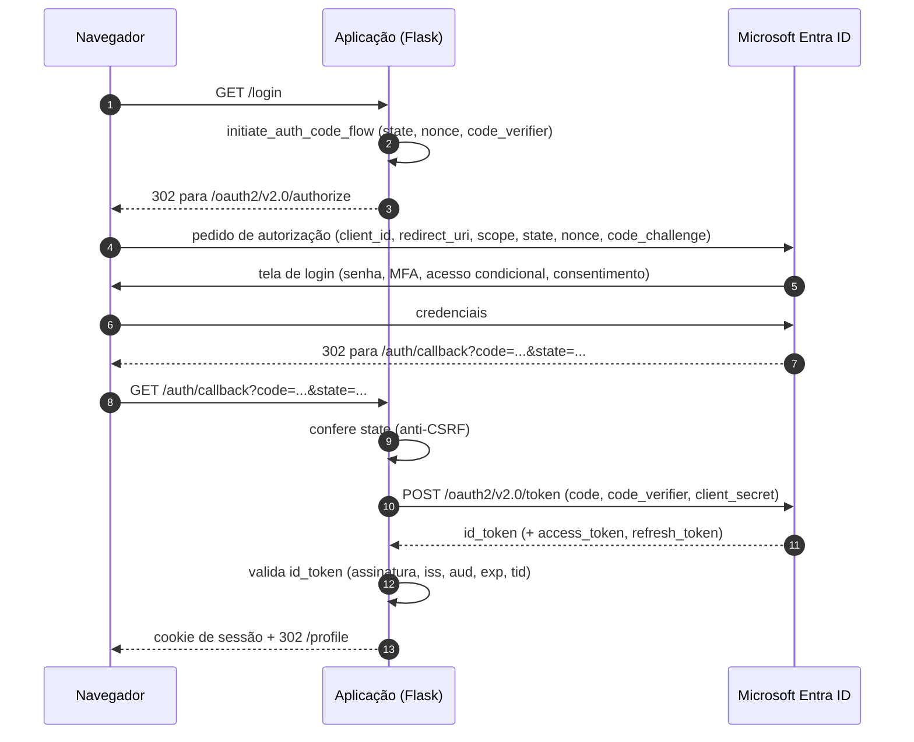

# Fluxo detalhado: Authorization Code com PKCE e OpenID Connect

## Parâmetros do pedido de autorização

| Parâmetro | Função |
|---|---|
| `client_id` | Identifica o app registrado no Entra. |
| `redirect_uri` | Para onde a Microsoft devolve o usuário. Precisa ser idêntico ao cadastrado. |
| `scope` | `openid profile offline_access`. `openid` pede o login (ID token). |
| `state` | Valor aleatório devolvido junto do código. Se não conferir, é tentativa de CSRF. |
| `nonce` | Vai dentro do ID token. Impede reaproveitar um token antigo (replay). |
| `code_challenge` | Hash (S256) do `code_verifier`. É o PKCE: quem roubar o `code` não consegue trocá-lo sem o verifier. |

## O que o ID token prova

Um JWT assinado pela Microsoft com, entre outras, estas claims:

| Claim | Significado | Como é verificada aqui |
|---|---|---|
| `iss` | Quem emitiu | Igual a `https://login.microsoftonline.com/<TENANT_ID>/v2.0` |
| `aud` | Para quem foi emitido | Igual ao `CLIENT_ID` |
| `exp`, `iat` | Validade | Obrigatórias, com tolerância de 120 s de relógio |
| `tid` | Tenant do usuário | Igual ao `TENANT_ID` |
| `nonce` | Anti-replay | Conferido pelo MSAL contra o valor guardado no `flow` |
| `oid` | ID do usuário no tenant (estável) | Guardado na sessão |
| `preferred_username` | Normalmente o UPN (e-mail corporativo) | Guardado na sessão, para exibição |

> Use `oid` (junto de `tid`) como identificador do usuário em sistemas que precisam de chave estável. O `preferred_username` pode mudar.

## O que o MSAL faz e o que não faz (versão 1.39)

| Faz | Não faz |
|---|---|
| Gera `state`, `nonce` e PKCE | Validar assinatura, `iss`, `aud` e `exp` do ID token |
| Confere `state` na volta | Decidir quem pode entrar |
| Troca o `code` por tokens | Guardar sessão da sua aplicação |
| Confere o hash do `nonce` | |

Por isso existe `validate_id_token()` em `auth.py`.
